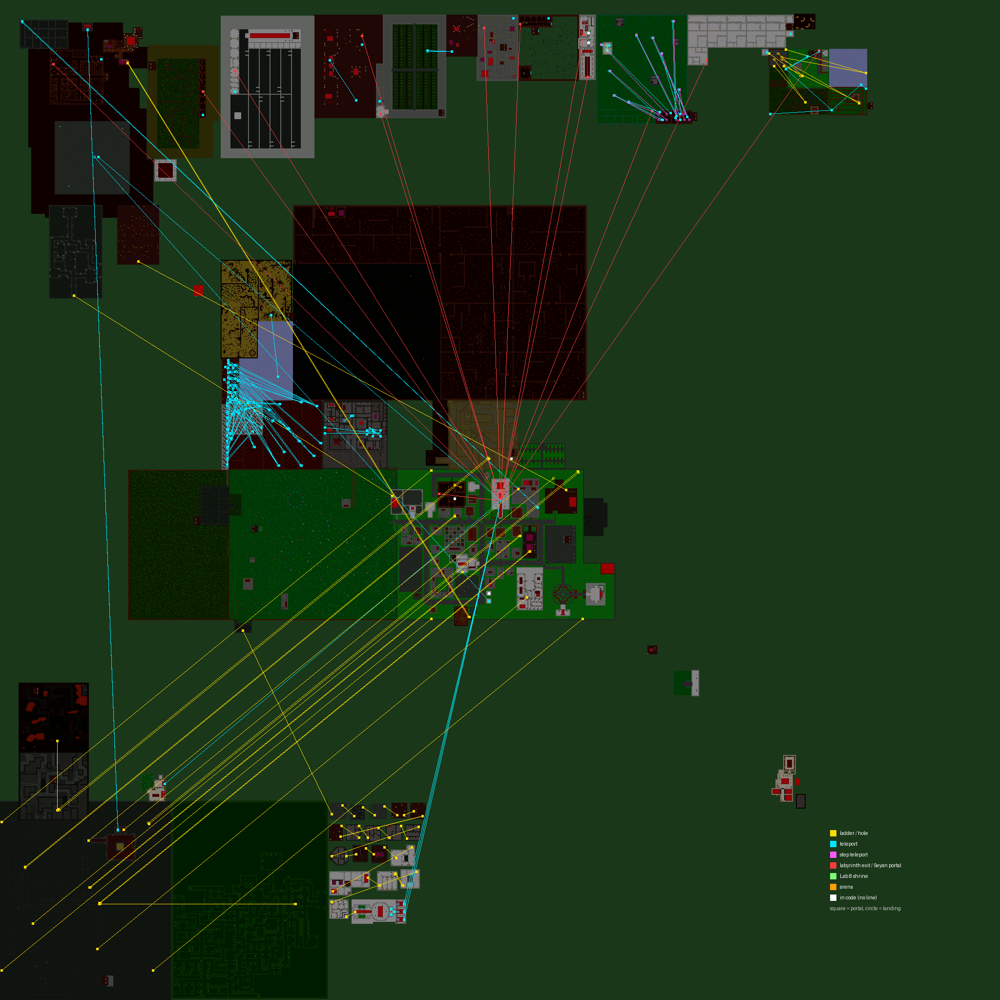

# World links

Every portal, teleporter, ladder and hole in the world: where it is, where it sends you, and whether the landing spot is free.
Generated by `tools/world/worldlinks.py` from the server data. Coordinates are map x,y (what `#goto x y` uses).

## Summary

| Kind | Count | Destination stored in |
|---|---|---|
| teleport | 118 | data[0],data[1] (absolute); if data[2]!=0 the destination is chosen in code (use_labtransfer) |
| ladder/hole | 79 | data[0],data[1] = OFFSET from the item itself (moves with it) |
| labyrinth exit | 12 | data[0],data[1] (absolute) |
| step teleport | 9 | data[0],data[1] (absolute) |
| special portal (code) | 2 | hard-coded in step_portal1_lab13() |
| special portal (code) | 2 | hard-coded in step_portal2_lab13() |
| arena portal | 1 | data[0]=fighter drop point, data[1]/data[2]=arena box corners, all as x+y*1024 |
| labyrinth entrance | 1 | destination per labyrinth level, hard-coded in use_labyrinth() |
| Seyan'Du portal | 1 | data[0],data[1] (absolute) |
| Lab 8 money shrine | 1 | data[1],data[2] (absolute) |

**Landing check:** all destinations have a free tile to land on.

## Coordinates hard-coded in the server source

These are not in the data files; moving one of these places means editing the code and rebuilding.

| File | Where | Coordinates |
|---|---|---|
| use_driver.c | use_labyrinth() | Labyrinth entrance (Aston, 607,500): one destination per labyrinth level: 64,56  95,207  74,240  37,370  114,390  28,493  24,534  118,667  63,720  33,597 |
| use_driver.c | finish_laby_teleport() | 512,512 (Temple of Skua) |
| use_driver.c | step_portal1/2_lab13() | Lab 13 portals: scan areas x 48-80 / y 593-608 |
| helper.c | use_labtransfer() | lab-solved fight arena 174,166; back to 512,512 |
| lab9.c | destinations[] | Riddle Gorge rewards: 39,729  40,749  40,769  40,789  34,806 |
| gendefs.h | HOME_MERCENARY_X/Y | 512,512: new characters, Skua temple (recall / death) |
| svr_do.c / svr_god.c | temple_x/y | 558,542 Temple of the Purple One; 813,165 staff temple; 512,512 Skua |
| server.c | line ~632 | recognizes temples at x 512 / 558 / 813 |
| svr_god.c | god_usurp() | 10,10 |
| area.c | area[] | 124 named rectangles (area names shown in game, used for this report) |
| char.dat / tchar.dat | temple_x/y, tavern_x/y, NPC positions | per character: recall/death temple, login tavern, NPC homes |

## All links by area

### (unnamed)

| Item | Kind | Name | At | Goes to | Check |
|---|---|---|---|---|---|
| 19833 | labyrinth exit | Magic Portal (lab 10 spring) | 51,838 | 512,512 Temple of Skua | ok |
| 20973 | ladder/hole | Teleport Wall (Lab 10 Winter) | 50,804 | 74,886 (unnamed) | ok (next to it) |
| 9735 | ladder/hole | Teleport Wall (Lab 10 Spring) | 54,787 | 77,819 (unnamed) | ok |
| 8648 | ladder/hole | Teleport Wall (Lab 10 Summer) | 67,792 | 104,824 (unnamed) | ok (next to it) |
| 21203 | ladder/hole | Teleport Wall (Lab 10 Fall) | 67,802 | 104,879 (unnamed) | ok (next to it) |
| 8694 | ladder/hole | Trap (Lab 10 Winter) | 74,886 | 58,800 (unnamed) | ok |
| 5070 | ladder/hole | Trap (Lab 10 Spring) | 77,821 | 54,796 (unnamed) | ok |
| 16108 | ladder/hole | Trap (Lab 10 Summer) | 104,824 | 60,792 (unnamed) | ok |
| 21017 | ladder/hole | Trap (Lab 10 Fall) | 105,879 | 60,800 (unnamed) | ok |
| 9806 | ladder/hole | Ladder (from Ghost King) | 267,141 | 501,579 Abandoned Gorn Clan Hall | ok (next to it) |
| 2963 | ladder/hole | Ladder (from Spider Queen) | 302,75 | 507,401 Abandoned Kwai Clan Hall | ok (next to it) |
| 5215 | teleport | Hole (to Room I in outlaw hideout | 30,89 | 850,120 Underground I | ok |
| 18357 | teleport | Magic Portal (Lab 10 End) | 53,785 | *lab-solved portal, destination in code* |  |
| 21202 | teleport | Magic Portal (To Summer) | 57,826 | 70,804 (unnamed) | ok (next to it) |
| 15951 | teleport | Magic Portal (To Spring) | 70,804 | 52,838 (unnamed) | ok |
| 7317 | teleport | Magic Portal (To Fall) | 86,881 | 112,851 (unnamed) | ok (next to it) |
| 1803 | teleport | Magic Portal (To Winter) | 90,886 | 86,881 (unnamed) | ok (next to it) |
| 17403 | teleport | Magic Portal (To Summer) | 112,851 | 70,804 (unnamed) | ok (next to it) |
| 7588 | teleport | Magic Portal (To Fall) | 116,788 | 112,851 (unnamed) | ok (next to it) |
| 16748 | teleport | Magic Portal | 322,277 | 385,284 Ice Pentagram Quest | ok (next to it) |

### Abandoned Gorn Clan Hall

| Item | Kind | Name | At | Goes to | Check |
|---|---|---|---|---|---|
| 8690 | ladder/hole | Hole (to Ghost King) | 501,579 | 267,141 (unnamed) | ok (next to it) |

### Abandoned Kwai Clan Hall

| Item | Kind | Name | At | Goes to | Check |
|---|---|---|---|---|---|
| 12072 | ladder/hole | Hole (to Spider Queen) | 507,401 | 302,75 (unnamed) | ok (next to it) |

### Arena

| Item | Kind | Name | At | Goes to | Check |
|---|---|---|---|---|---|
| 12346 | arena portal | Magic Gate II | 496,465 | 498,471 Arena | ok |
| 37179 | labyrinth exit | Magic Portal | 505,449 | 512,512 Temple of Skua | ok |
| 16320 | special portal (code) | Magic Gate II | 510,465 | *destination in code* |  |

### Aston

| Item | Kind | Name | At | Goes to | Check |
|---|---|---|---|---|---|
| 1246 | labyrinth entrance | Magic Portal | 607,500 | *destination in code* |  |
| 13724 | ladder/hole | Hole | 481,441 | 841,1 Underground I | ok (next to it) |
| 5121 | ladder/hole | Hole | 482,591 | 842,151 Underground I | ok |
| 17119 | ladder/hole | Hole | 585,473 | 945,33 Underground I | ok (next to it) |
| 15241 | ladder/hole | Hole | 633,441 | 993,1 Underground I | ok (next to it) |
| 2581 | teleport | Magic Portal | 615,500 | 160,96 Random Dungeon | ok |

### Astonian Inn

| Item | Kind | Name | At | Goes to | Check |
|---|---|---|---|---|---|
| 11451 | ladder/hole | Hole | 64,130 | 631,479 Astonian Inn | ok |
| 9850 | ladder/hole | Tavern Ladder | 631,480 | 63,130 Astonian Inn | ok |

### Black Stronghold

| Item | Kind | Name | At | Goes to | Check |
|---|---|---|---|---|---|
| 11817 | teleport | Black Stronghold Iron Door | 425,359 | 425,361 Black Stronghold | ok |
| 13097 | teleport | Black Stronghold Iron Door | 425,360 | 430,352 Black Stronghold | ok |
| 3942 | teleport | Fire in Bowl | 437,332 | 443,388 Black Stronghold | ok |
| 1404 | teleport | Fire in Bowl | 440,375 | 443,388 Black Stronghold | ok |
| 13538 | teleport | Fire in Bowl | 440,381 | 438,378 Black Stronghold | ok |
| 10366 | teleport | Fire in Bowl | 440,389 | 438,378 Black Stronghold | ok |
| 23291 | teleport | Fire in Bowl | 443,332 | 443,388 Black Stronghold | ok |
| 12972 | teleport | Fire in Bowl | 444,375 | 438,378 Black Stronghold | ok |
| 12164 | teleport | Fire in Bowl | 446,381 | 440,383 Black Stronghold | ok |
| 11478 | teleport | Fire in Bowl | 446,389 | 438,378 Black Stronghold | ok |

### Gargoyle's Nest

| Item | Kind | Name | At | Goes to | Check |
|---|---|---|---|---|---|
| 22291 | teleport | Portal: floor tile 13 | 368,233 | 374,233 Gargoyle's Nest | ok |
| 2647 | teleport | Ladder GN8 | 371,233 | 415,323 Gargoyle's Nest | ok |
| 22296 | teleport | Ladder GN7 | 373,235 | 453,327 Gargoyle's Nest | ok |
| 22356 | teleport | Ladder GN6 | 373,240 | 466,320 Gargoyle's Nest | ok |
| 832 | teleport | Portal: floor tile 14 | 375,230 | 379,233 Gargoyle's Nest | ok |
| 20390 | teleport | Ladder GN8 | 376,233 | 415,323 Gargoyle's Nest | ok |
| 7594 | teleport | Portal: floor tile 10 | 376,238 | 373,242 Gargoyle's Nest | ok |
| 20336 | teleport | Ladder GN6 | 380,235 | 466,320 Gargoyle's Nest | ok |
| 22083 | teleport | Ladder GN5 | 380,240 | 451,305 Gargoyle's Nest | ok |
| 2844 | teleport | Ladder GN8 | 381,233 | 415,323 Gargoyle's Nest | ok |
| 9716 | teleport | Ladder GN9 | 386,233 | 411,307 Gargoyle's Nest | ok |
| 5440 | teleport | Ladder GN5 | 387,235 | 462,291 Gargoyle's Nest | ok |
| 20906 | teleport | Ladder GN4 | 387,240 | 476,307 Gargoyle's Nest | ok |
| 13296 | teleport | Portal: floor tile 17 | 388,229 | 394,233 Gargoyle's Nest | ok |
| 17278 | teleport | Portal: floor tile 6 | 389,243 | 394,237 Gargoyle's Nest | ok |
| 14565 | teleport | Ladder GN10 | 391,233 | 438,294 Gargoyle's Nest | ok |
| 1249 | teleport | Ladder GN3 | 394,235 | 476,284 Gargoyle's Nest | ok |
| 19933 | teleport | Ladder GN3 | 394,240 | 476,284 Gargoyle's Nest | ok |
| 19296 | teleport | Ladder GN10 | 396,233 | 438,294 Gargoyle's Nest | ok |
| 17896 | teleport | Portal: floor tile 5 | 397,238 | 394,242 Gargoyle's Nest | ok |
| 22519 | teleport | Ladder GN11 | 401,233 | 419,276 Gargoyle's Nest | ok |
| 19295 | teleport | Ladder GN3 | 401,235 | 476,284 Gargoyle's Nest | ok |
| 10439 | teleport | Ladder GN2 | 401,240 | 457,259 Gargoyle's Nest | ok |
| 1335 | teleport | Portal: floor tile 3 | 405,237 | 401,242 Gargoyle's Nest | ok |
| 11888 | teleport | Ladder GN12 | 406,233 | 431,278 Gargoyle's Nest | ok |
| 3285 | teleport | Ladder GN2 | 408,235 | 457,259 Gargoyle's Nest | ok |
| 10165 | teleport | Ladder GN1 | 408,240 | 449,237 Gargoyle's Nest | ok |
| 10421 | teleport | Portal: floor tile 25 | 411,235 | 441,232 Gargoyle's Nest | ok |
| 18473 | teleport | Portal: floor tile 24 | 411,244 | 435,232 Gargoyle's Nest | ok |
| 9956 | teleport | Portal: floor tile 15 | 411,308 | 384,233 Gargoyle's Nest | ok |
| 10263 | teleport | Ladder GN13 | 412,232 | 413,285 Gargoyle's Nest | ok |
| 9796 | teleport | Portal: floor tile 23 | 412,253 | 429,232 Gargoyle's Nest | ok |
| 10214 | teleport | Portal: floor tile 20 | 413,286 | 409,232 Gargoyle's Nest | ok |
| 2675 | teleport | Ladder GN14 | 415,232 | 437,267 Gargoyle's Nest | ok |
| 9892 | teleport | Portal: floor tile 22 | 415,265 | 423,232 Gargoyle's Nest | ok |
| 15801 | teleport | Portal: floor tile 12 | 415,324 | 369,233 Gargoyle's Nest | ok |
| 15233 | teleport | Portal: floor tile 28 | 418,251 | 459,232 Gargoyle's Nest | ok |
| 21977 | teleport | Portal: floor tile 18 | 419,275 | 399,233 Gargoyle's Nest | ok |
| 6450 | teleport | Portal: floor tile 29 | 420,260 | 465,232 Gargoyle's Nest | ok |
| 24128 | teleport | Ladder GN15 | 421,232 | 415,265 Gargoyle's Nest | ok |
| 23944 | teleport | Portal: floor tile 27 | 422,244 | 453,232 Gargoyle's Nest | ok |
| 6490 | teleport | Portal: floor tile 26 | 423,237 | 447,232 Gargoyle's Nest | ok |
| 5729 | teleport | Ladder GN16 | 427,232 | 412,253 Gargoyle's Nest | ok |
| 21186 | teleport | Portal: floor tile 19 | 430,279 | 404,233 Gargoyle's Nest | ok |
| 13001 | teleport | Ladder GN17 | 433,232 | 411,244 Gargoyle's Nest | ok |
| 7123 | teleport | Portal: floor tile 21 | 437,267 | 417,232 Gargoyle's Nest | ok |
| 12377 | teleport | Portal: floor tile 16 | 438,295 | 389,233 Gargoyle's Nest | ok |
| 12600 | teleport | Ladder GN18 | 439,232 | 411,235 Gargoyle's Nest | ok |
| 20754 | teleport | Portal: floor tile 30 | 441,258 | 471,232 Gargoyle's Nest | ok |
| 16643 | teleport | Portal: floor tile 31 | 443,235 | 477,232 Gargoyle's Nest | ok |
| 19353 | teleport | Ladder GN19 | 445,232 | 423,237 Gargoyle's Nest | ok |
| 19065 | teleport | Portal: floor tile 1 | 448,236 | 408,242 Gargoyle's Nest | ok |
| 7493 | teleport | Ladder GN20 | 451,232 | 422,244 Gargoyle's Nest | ok |
| 6158 | teleport | Portal: floor tile 9 | 451,306 | 380,242 Gargoyle's Nest | ok |
| 22840 | teleport | Portal: floor tile 11 | 453,328 | 373,237 Gargoyle's Nest | ok |
| 23196 | teleport | Ladder GN21 | 457,232 | 418,251 Gargoyle's Nest | ok |
| 6611 | teleport | Portal: floor tile 2 | 457,260 | 408,237 Gargoyle's Nest | ok |
| 18231 | teleport | Portal: floor tile 8 | 462,290 | 387,237 Gargoyle's Nest | ok |
| 10611 | teleport | Ladder GN22 | 463,232 | 420,260 Gargoyle's Nest | ok |
| 7349 | teleport | Portal: floor tile 9 | 466,321 | 380,237 Gargoyle's Nest | ok |
| 20421 | teleport | Ladder GN23 | 469,232 | 441,258 Gargoyle's Nest | ok |
| 18518 | teleport | Ladder GN24 | 475,232 | 443,235 Gargoyle's Nest | ok |
| 14677 | teleport | Portal: floor tile 4 | 476,285 | 401,237 Gargoyle's Nest | ok |
| 15403 | teleport | Portal: floor tile 7 | 476,308 | 387,242 Gargoyle's Nest | ok |

### Haunted Castle

| Item | Kind | Name | At | Goes to | Check |
|---|---|---|---|---|---|
| 5841 | ladder/hole | Hole | 611,539 | 971,99 Underground I | ok (next to it) |

### Ice Pentagram Quest

| Item | Kind | Name | At | Goes to | Check |
|---|---|---|---|---|---|
| 14730 | teleport | Magic Portal | 385,284 | 322,277 (unnamed) | ok (next to it) |

### Jamil's House

| Item | Kind | Name | At | Goes to | Check |
|---|---|---|---|---|---|
| 1446 | ladder/hole | Hole | 548,532 | 908,92 Underground I | ok |

### Labyrinth, Final Entry

| Item | Kind | Name | At | Goes to | Check |
|---|---|---|---|---|---|
| 15214 | labyrinth exit | Magic Portal | 35,597 | 512,512 Temple of Skua | ok |
| 15401 | special portal (code) | Magic Gate II | 33,602 | *destination in code* |  |

### Labyrinth, Final Reward

| Item | Kind | Name | At | Goes to | Check |
|---|---|---|---|---|---|
| 14376 | Seyan'Du portal | Magic Portal | 78,601 | 512,512 Temple of Skua | ok |

### Labyrinth, Final Test

| Item | Kind | Name | At | Goes to | Check |
|---|---|---|---|---|---|
| 15399 | special portal (code) | Magic Gate II | 43,602 | *destination in code* |  |

### Labyrinth, Forest Gorge

| Item | Kind | Name | At | Goes to | Check |
|---|---|---|---|---|---|
| 23378 | Lab 8 money shrine | Shrine in lab 8 for portal | 51,621 | 46,621 Labyrinth, Forest Gorge | ok |
| 24811 | labyrinth exit | Magic Portal | 113,667 | 512,512 Temple of Skua | ok |
| 23638 | step teleport | Portal: floor trap 6 | 21,689 | 122,692 Labyrinth, Forest Gorge | ok |
| 23977 | step teleport | Portal: floor trap 5 | 35,651 | 116,692 Labyrinth, Forest Gorge | ok |
| 2915 | step teleport | Portal: floor trap 9 | 38,668 | 122,705 Labyrinth, Forest Gorge | ok |
| 23757 | step teleport | Portal: floor trap 4 | 45,615 | 116,682 Labyrinth, Forest Gorge | ok |
| 16806 | step teleport | Portal: floor trap 7 | 54,677 | 122,700 Labyrinth, Forest Gorge | ok |
| 20092 | step teleport | Portal: floor trap 3 | 72,624 | 122,682 Labyrinth, Forest Gorge | ok |
| 1076 | step teleport | Portal: floor trap 8 | 91,695 | 116,700 Labyrinth, Forest Gorge | ok |
| 17202 | step teleport | Portal: floor trap 2 | 97,628 | 122,674 Labyrinth, Forest Gorge | ok |
| 23476 | step teleport | Portal: floor trap 1 | 104,643 | 116,674 Labyrinth, Forest Gorge | ok |
| 18319 | teleport | Magic Portal | 46,623 | *lab-solved portal, destination in code* |  |
| 2041 | teleport | Earth Wall, portal 1 | 114,675 | 103,643 Labyrinth, Forest Gorge | ok |
| 2810 | teleport | Earth Wall, portal 4 | 115,686 | 45,616 Labyrinth, Forest Gorge | ok |
| 493 | teleport | Earth Wall, portal 8 | 116,696 | 91,694 Labyrinth, Forest Gorge | ok |
| 913 | teleport | Earth Wall, portal 5 | 118,692 | 36,651 Labyrinth, Forest Gorge | ok |
| 23272 | teleport | Earth Wall, portal 9 | 119,703 | 38,667 Labyrinth, Forest Gorge | ok |
| 22690 | teleport | Earth Wall, portal 6 | 120,691 | 21,688 Labyrinth, Forest Gorge | ok |
| 23498 | teleport | Earth Wall, portal 2 | 122,677 | 97,629 Labyrinth, Forest Gorge | ok |
| 40 | teleport | Earth Wall, portal 3 | 122,678 | 72,623 Labyrinth, Forest Gorge | ok |
| 24147 | teleport | Earth Wall, portal 7 | 122,696 | 54,676 Labyrinth, Forest Gorge | ok |

### Labyrinth, Grolm Gorge

| Item | Kind | Name | At | Goes to | Check |
|---|---|---|---|---|---|
| 15085 | labyrinth exit | Magic Portal | 65,54 | 512,512 Temple of Skua | ok |
| 1153 | teleport | Magic Portal | 60,103 | *lab-solved portal, destination in code* |  |

### Labyrinth, Knight Gorge

| Item | Kind | Name | At | Goes to | Check |
|---|---|---|---|---|---|
| 15151 | labyrinth exit | Magic Portal | 36,370 | 512,512 Temple of Skua | ok |
| 3584 | teleport | Magic Portal | 45,370 | *lab-solved portal, destination in code* |  |
| 308 | teleport | Carpet | 61,337 | 102,364 Labyrinth, Knight Gorge | ok (next to it) |
| 3591 | teleport | Ladder | 102,364 | 61,337 Labyrinth, Knight Gorge | ok |

### Labyrinth, Light&Dark Gorge

| Item | Kind | Name | At | Goes to | Check |
|---|---|---|---|---|---|
| 15084 | labyrinth exit | Magic Portal | 28,495 | 512,512 Temple of Skua | ok |
| 14666 | teleport | Magic Portal | 18,525 | *lab-solved portal, destination in code* |  |

### Labyrinth, Lizard Gorge

| Item | Kind | Name | At | Goes to | Check |
|---|---|---|---|---|---|
| 1238 | labyrinth exit | Magic Portal | 93,207 | 512,512 Temple of Skua | ok |
| 2135 | teleport | Magic Portal | 117,207 | *lab-solved portal, destination in code* |  |

### Labyrinth, Riddle Gorge

| Item | Kind | Name | At | Goes to | Check |
|---|---|---|---|---|---|
| 26915 | labyrinth exit | Magic Portal | 61,723 | 512,512 Temple of Skua | ok |
| 17777 | teleport | Magic Portal | 34,809 | *lab-solved portal, destination in code* |  |

### Labyrinth, Spellcaster Gorge

| Item | Kind | Name | At | Goes to | Check |
|---|---|---|---|---|---|
| 15069 | labyrinth exit | Magic Portal | 72,240 | 512,512 Temple of Skua | ok |
| 3474 | teleport | Magic Portal | 93,240 | *lab-solved portal, destination in code* |  |

### Labyrinth, Undead Gorge

| Item | Kind | Name | At | Goes to | Check |
|---|---|---|---|---|---|
| 15152 | labyrinth exit | Magic Portal | 116,389 | 512,512 Temple of Skua | ok |
| 3621 | teleport | Grave | 51,437 | 52,462 Labyrinth, Undead Gorge | ok (next to it) |
| 9657 | teleport | Ladder | 52,462 | 52,437 Labyrinth, Undead Gorge | ok |
| 9755 | teleport | Magic Portal | 103,388 | *lab-solved portal, destination in code* |  |

### Labyrinth, Water Gorge

| Item | Kind | Name | At | Goes to | Check |
|---|---|---|---|---|---|
| 14915 | labyrinth exit | Magic Portal | 24,532 | 512,512 Temple of Skua | ok |
| 10102 | teleport | Magic Portal | 18,561 | *lab-solved portal, destination in code* |  |

### Memorial Park

| Item | Kind | Name | At | Goes to | Check |
|---|---|---|---|---|---|
| 3055 | ladder/hole | Hole | 633,596 | 993,156 Underground I | ok (next to it) |

### Mine, 1st Level

| Item | Kind | Name | At | Goes to | Check |
|---|---|---|---|---|---|
| 3675 | ladder/hole | Hole | 469,500 | 829,60 Mine, 2nd Level | ok |
| 7495 | special portal (code) | Clan Pentagram | 469,523 | *destination in code* |  |

### Mine, 2nd Level

| Item | Kind | Name | At | Goes to | Check |
|---|---|---|---|---|---|
| 6219 | ladder/hole | Ladder I | 828,59 | 468,499 Mine, 1st Level | ok |
| 3532 | ladder/hole | Hole | 829,58 | 758,58 Mine, 3rd Level | ok (next to it) |

### Mine, 3rd Level

| Item | Kind | Name | At | Goes to | Check |
|---|---|---|---|---|---|
| 3726 | ladder/hole | Ladder I | 758,58 | 829,58 Mine, 2nd Level | ok (next to it) |

### Random Dungeon

| Item | Kind | Name | At | Goes to | Check |
|---|---|---|---|---|---|
| 2342 | teleport | Magic Portal | 160,100 | 512,512 Temple of Skua | ok |

### Staffers Corner

| Item | Kind | Name | At | Goes to | Check |
|---|---|---|---|---|---|
| 11976 | teleport | Magic Portal | 802,168 | 512,512 Temple of Skua | ok |

### Steven's House

| Item | Kind | Name | At | Goes to | Check |
|---|---|---|---|---|---|
| 6800 | ladder/hole | Hole | 528,465 | 888,25 Underground I | ok |

### Temple of the Purple One

| Item | Kind | Name | At | Goes to | Check |
|---|---|---|---|---|---|
| 14203 | ladder/hole | Hole | 564,542 | 924,102 Underground I | ok |

### Thieves Basement

| Item | Kind | Name | At | Goes to | Check |
|---|---|---|---|---|---|
| 17097 | teleport | barrel (portal) | 21,22 | 518,549 Thieves House I | ok |

### Thieves House I

| Item | Kind | Name | At | Goes to | Check |
|---|---|---|---|---|---|
| 15595 | teleport | barrel (portal) | 519,550 | 22,22 Thieves Basement | ok |

### Thieves House II

| Item | Kind | Name | At | Goes to | Check |
|---|---|---|---|---|---|
| 11627 | ladder/hole | Hole | 500,530 | 860,90 Underground I | ok (next to it) |

### Tower I

| Item | Kind | Name | At | Goes to | Check |
|---|---|---|---|---|---|
| 16716 | ladder/hole | Tower Ladder 1 to 2 | 645,248 | 833,339 Tower II | ok (next to it) |

### Tower II

| Item | Kind | Name | At | Goes to | Check |
|---|---|---|---|---|---|
| 12162 | ladder/hole | Tower Ladder | 824,350 | 835,362 Tower III | ok (next to it) |
| 4706 | ladder/hole | Hole (tower level 2 to 1) | 833,339 | 645,248 Tower I | ok (next to it) |

### Tower III

| Item | Kind | Name | At | Goes to | Check |
|---|---|---|---|---|---|
| 7630 | ladder/hole | Tower Ladder | 826,371 | 834,383 Tower IV | ok (next to it) |
| 7303 | ladder/hole | Hole | 835,362 | 824,350 Tower II | ok (next to it) |

### Tower IV

| Item | Kind | Name | At | Goes to | Check |
|---|---|---|---|---|---|
| 5074 | ladder/hole | Tower Ladder | 825,393 | 834,406 Tower V | ok (next to it) |
| 5466 | ladder/hole | Hole | 834,383 | 826,371 Tower III | ok (next to it) |

### Tower IX

| Item | Kind | Name | At | Goes to | Check |
|---|---|---|---|---|---|
| 3165 | ladder/hole | Tower Ladder | 847,387 | 857,398 Tower X | ok (next to it) |
| 6885 | ladder/hole | Hole | 857,376 | 845,367 Tower VIII | ok (next to it) |

### Tower V

| Item | Kind | Name | At | Goes to | Check |
|---|---|---|---|---|---|
| 1571 | ladder/hole | Hole | 834,406 | 825,393 Tower IV | ok (next to it) |
| 2372 | ladder/hole | Tower Ladder | 834,413 | 830,423 Tower VI | ok (next to it) |

### Tower VI

| Item | Kind | Name | At | Goes to | Check |
|---|---|---|---|---|---|
| 36 | ladder/hole | Hole | 830,423 | 834,413 Tower V | ok (next to it) |
| 1577 | ladder/hole | Tower Ladder 6 to 7 | 835,432 | 856,348 Tower VII | ok (next to it) |

### Tower VII

| Item | Kind | Name | At | Goes to | Check |
|---|---|---|---|---|---|
| 6777 | ladder/hole | Tower Ladder | 845,349 | 857,367 Tower VIII | ok (next to it) |
| 18398 | ladder/hole | Hole (tower level 7 to 6) | 856,348 | 835,432 Tower VI | ok (next to it) |

### Tower VIII

| Item | Kind | Name | At | Goes to | Check |
|---|---|---|---|---|---|
| 12110 | ladder/hole | Tower Ladder | 845,367 | 857,376 Tower IX | ok (next to it) |
| 2715 | ladder/hole | Hole | 857,367 | 845,349 Tower VII | ok (next to it) |

### Tower X

| Item | Kind | Name | At | Goes to | Check |
|---|---|---|---|---|---|
| 4746 | ladder/hole | Tower Ladder | 845,410 | 858,416 Tower XI | ok (next to it) |
| 1615 | ladder/hole | Hole | 857,398 | 847,387 Tower IX | ok (next to it) |

### Tower XI

| Item | Kind | Name | At | Goes to | Check |
|---|---|---|---|---|---|
| 7251 | ladder/hole | Tower Ladder | 846,428 | 876,339 Tower XII | ok (next to it) |
| 16052 | ladder/hole | Hole | 858,416 | 845,410 Tower X | ok (next to it) |

### Tower XII

| Item | Kind | Name | At | Goes to | Check |
|---|---|---|---|---|---|
| 5222 | ladder/hole | Hole | 876,339 | 846,428 Tower XI | ok (next to it) |
| 6928 | ladder/hole | Tower Ladder 12 to 13 | 876,354 | 874,364 Tower XIII | ok (next to it) |

### Tower XIII

| Item | Kind | Name | At | Goes to | Check |
|---|---|---|---|---|---|
| 14431 | ladder/hole | Tower Ladder 13 to 14 | 868,374 | 874,382 Tower XIV | ok (next to it) |
| 13074 | ladder/hole | Hole (tower level 13 to 12) | 874,364 | 876,354 Tower XII | ok (next to it) |

### Tower XIV

| Item | Kind | Name | At | Goes to | Check |
|---|---|---|---|---|---|
| 7507 | ladder/hole | Tower Ladder 14 to 15 | 867,393 | 878,405 Tower XV | ok (next to it) |
| 8777 | ladder/hole | Hole (tower level 14 to 13) | 874,382 | 868,374 Tower XIII | ok (next to it) |

### Tower XIX

| Item | Kind | Name | At | Goes to | Check |
|---|---|---|---|---|---|
| 16786 | ladder/hole | Hole (tower level 19 to 18) | 923,339 | 892,426 Tower XVIII | ok (next to it) |
| 18480 | ladder/hole | Tower Ladder 19 to 20 | 938,354 | 933,363 Tower XX | ok (next to it) |

### Tower XV

| Item | Kind | Name | At | Goes to | Check |
|---|---|---|---|---|---|
| 11453 | ladder/hole | Tower Ladder 15 to 16 | 867,421 | 912,340 Tower XVI | ok (next to it) |
| 20139 | ladder/hole | Hole (tower level 15 to 14) | 878,405 | 867,393 Tower XIV | ok (next to it) |

### Tower XVI

| Item | Kind | Name | At | Goes to | Check |
|---|---|---|---|---|---|
| 20148 | ladder/hole | Tower Ladder 16 to 17 | 898,376 | 906,388 Tower XVII | ok (next to it) |
| 1917 | ladder/hole | Hole (tower level 16 to 15) | 912,340 | 867,421 Tower XV | ok (next to it) |

### Tower XVII

| Item | Kind | Name | At | Goes to | Check |
|---|---|---|---|---|---|
| 3957 | ladder/hole | Tower Ladder 17 to 18 | 894,404 | 906,411 Tower XVIII | ok |
| 20014 | ladder/hole | Hole (tower level 17 to 16) | 906,388 | 898,376 Tower XVI | ok (next to it) |

### Tower XVIII

| Item | Kind | Name | At | Goes to | Check |
|---|---|---|---|---|---|
| 9336 | ladder/hole | Tower Ladder 18 to 19 | 892,426 | 923,339 Tower XIX | ok (next to it) |
| 6552 | ladder/hole | Hole (tower level 18 to 17) | 906,412 | 894,405 Tower XVII | ok |

### Tower XX

| Item | Kind | Name | At | Goes to | Check |
|---|---|---|---|---|---|
| 11662 | ladder/hole | Hole (tower level 20 to 19) | 933,363 | 938,354 Tower XIX | ok (next to it) |
| 17507 | teleport | Magic Portal | 925,413 | 512,512 Temple of Skua | ok |
| 8990 | teleport | Magic Portal | 930,400 | 925,407 Tower XX | ok |
| 10799 | teleport | Magic Portal | 933,403 | 933,407 Tower XX | ok |
| 17300 | teleport | Magic Portal | 933,413 | 512,512 Temple of Skua | ok |
| 16100 | teleport | Magic Portal | 936,400 | 941,407 Tower XX | ok |
| 18856 | teleport | Magic Portal | 941,413 | 512,512 Temple of Skua | ok |

### Underground I

| Item | Kind | Name | At | Goes to | Check |
|---|---|---|---|---|---|
| 2984 | ladder/hole | Ladder I | 841,1 | 481,441 Aston | ok (next to it) |
| 12688 | ladder/hole | Ladder I | 843,152 | 483,592 Aston | ok |
| 4283 | ladder/hole | Ladder (Outlaw Hideout Room 2) | 849,126 | 489,566 Aston | ok |
| 2427 | ladder/hole | Ladder II | 860,90 | 500,530 Thieves House II | ok (next to it) |
| 2923 | ladder/hole | Ladder II | 887,25 | 527,465 Steven's House | ok |
| 2728 | ladder/hole | Ladder II | 908,91 | 548,531 Jamil's House | ok |
| 2691 | ladder/hole | Ladder I | 924,101 | 564,541 Temple of the Purple One | ok |
| 13966 | ladder/hole | Hole | 925,101 | 925,301 Underground II | ok |
| 2958 | ladder/hole | Ladder II | 945,33 | 585,473 Aston | ok (next to it) |
| 2928 | ladder/hole | Ladder I | 971,99 | 611,539 Haunted Castle | ok (next to it) |
| 1530 | ladder/hole | Ladder I | 993,1 | 633,441 Aston | ok (next to it) |
| 3064 | ladder/hole | Ladder II | 993,156 | 633,596 Memorial Park | ok (next to it) |
| 11439 | teleport | Ladder (Outlaw hideout Room 1) | 849,120 | 29,89 (unnamed) | ok |

### Underground II

| Item | Kind | Name | At | Goes to | Check |
|---|---|---|---|---|---|
| 10754 | ladder/hole | Ladder I | 925,302 | 925,102 Underground I | ok |
