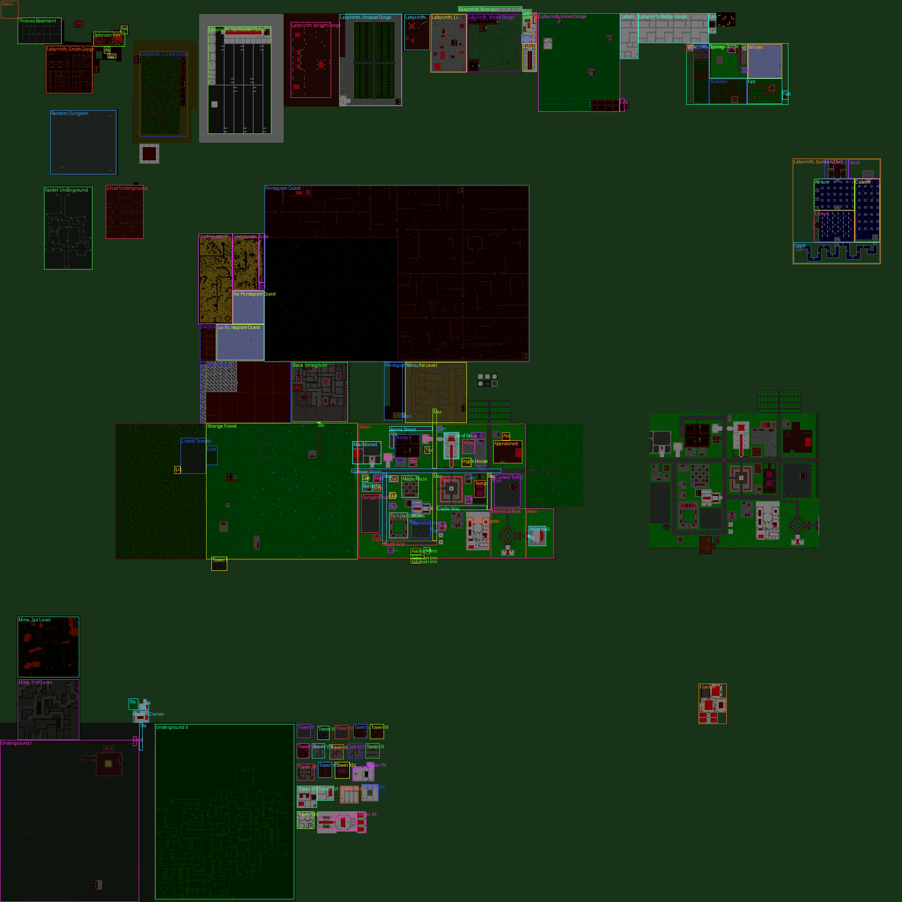

# Zones

Zones come from `.dat/zones.dat` (written by the MyV2 Editor's Zones tab): boxes of map x1,y1 - x2,y2. Every box with the same name is part of one zone (odd shapes are several boxes).
Shown by `/who`, by NPCs when asked where you are, and in server logs. A spot inside several zones shows each name once, in table order.

| # | Name | x1,y1 | x2,y2 | Says |
|---|---|---|---|---|
| 0 | Aston | 481,407 | 633,596 | "in Aston" |
| 1 | Aston | 1,1 | 20,20 | "in Aston" |
| 2 | Aston | 532,406 | 536,406 | "in Aston" |
| 3 | Aston | 577,597 | 633,628 | "in Aston" |
| 4 | Lizard Temple | 497,205 | 537,233 | "in the Lizard Temple" |
| 5 | Lizard Temple | 506,234 | 527,246 | "in the Lizard Temple" |
| 6 | Strange Forest | 480,234 | 634,405 | "in the Strange Forest" |
| 7 | Underground I | 840,0 | 1023,157 | "in Underground I" |
| 8 | Underground I | 836,151 | 846,154 | "in Underground I" |
| 9 | Temple of Skua | 491,504 | 520,520 | "in the Temple of Skua" |
| 10 | Temple of the Purple One | 545,538 | 564,550 | "in the Temple of the Purple One" |
| 11 | Thieves House I | 499,539 | 528,550 | "in the Thieves House I" |
| 12 | Thieves House I | 491,535 | 498,550 | "in the Thieves House I" |
| 13 | Thieves House I | 529,542 | 530,544 | "in the Thieves House I" |
| 14 | Thieves Basement | 20,20 | 49,69 | "in the Thieves Basement" |
| 15 | Thieves House II | 499,525 | 514,538 | "in the Thieves House II" |
| 16 | Temple Street | 532,399 | 536,568 | "on Temple Street" |
| 17 | Rose Street | 537,553 | 578,557 | "on Rose Street" |
| 18 | Cursed Tomb | 538,561 | 575,590 | "in the Cursed Tomb" |
| 19 | Cursed Tomb | 542,559 | 544,560 | "in the Cursed Tomb" |
| 20 | Castle Way | 574,496 | 578,552 | "on Castle Way" |
| 21 | Haunted Castle | 588,530 | 623,554 | "in the Haunted Castle" |
| 22 | Damor's Magic Shop | 569,468 | 582,487 | "in Damor's Magic Shop" |
| 23 | Tavern of the Blue Ogre | 507,482 | 514,487 | "in the Tavern of the Blue Ogre" |
| 24 | Bank | 515,436 | 522,444 | "in the Bank" |
| 25 | Bank | 493,479 | 503,486 | "in the Bank" |
| 26 | Arena Street | 484,442 | 488,490 | "on Arena Street" |
| 27 | Arena Street | 489,442 | 508,446 | "on Arena Street" |
| 28 | Cirrus' House | 540,442 | 546,451 | "in Cirrus' House" |
| 29 | Gunther's House | 621,440 | 627,446 | "in Gunther's House" |
| 30 | Robin's House | 621,481 | 628,487 | "in Robin's House" |
| 31 | Syleia's House | 607,423 | 613,431 | "in Syleia's House" |
| 32 | Gina's Shop | 483,497 | 490,501 | "in Gina's Shop" |
| 33 | Garna's Shop | 539,411 | 546,417 | "in Garna's Shop" |
| 34 | Manfred's House | 539,424 | 547,431 | "in Manfred's House" |
| 35 | Barracks | 548,411 | 557,422 | "in the Barracks" |
| 36 | Leopold's House | 550,424 | 557,431 | "in Leopold's House" |
| 37 | Serena's House | 521,450 | 528,459 | "in Serena's House" |
| 38 | Magic Maze | 540,456 | 564,474 | "in the Magic Maze" |
| 39 | Steven's House | 520,464 | 529,472 | "in Steven's House" |
| 40 | New Street | 537,434 | 616,438 | "on New Street" |
| 41 | Gordon's House | 559,442 | 565,448 | "in Gordon's House" |
| 42 | Nasir's House | 571,442 | 577,448 | "in Nasir's House" |
| 43 | Templar Outlaws | 582,442 | 610,462 | "at Templar Outlaws" |
| 44 | South End | 614,434 | 618,495 | "on South End" |
| 45 | Skeleton Lord | 590,467 | 610,488 | "at Skeleton Lord" |
| 46 | Skeleton Lord | 590,465 | 592,466 | "at Skeleton Lord" |
| 47 | Skeleton Lord | 599,489 | 601,490 | "at Skeleton Lord" |
| 48 | Merchant's Way | 537,491 | 613,495 | "on Merchant's Way" |
| 49 | Merchant's Way | 464,491 | 531,495 | "on Merchant's Way" |
| 50 | Ingrid's House | 593,498 | 601,505 | "in Ingrid's House" |
| 51 | Abandoned Kwai Clan Hall | 501,400 | 526,432 | "in the Abandoned Kwai Clan Hall" |
| 52 | Abandoned Gorn Clan Hall | 500,560 | 525,592 | "in the Abandoned Gorn Clan Hall" |
| 53 | Abandoned Gorn Clan Hall | 491,570 | 499,578 | "in the Abandoned Gorn Clan Hall" |
| 54 | Arena | 493,448 | 519,476 | "in the Arena" |
| 55 | Black Stronghold | 411,331 | 478,394 | "in the Black Stronghold" |
| 56 | Black Stronghold | 479,360 | 479,363 | "in the Black Stronghold" |
| 57 | Dungeon of Doors | 561,410 | 604,430 | "in the Dungeon of Doors" |
| 58 | Dungeon of Doors | 561,431 | 563,432 | "in the Dungeon of Doors" |
| 59 | Random Dungeon | 125,57 | 197,131 | "in the Random Dungeon" |
| 60 | Mine, 1st Level | 411,460 | 479,529 | "in the Mine, 1st Level" |
| 61 | Mine, 2nd Level | 771,20 | 839,89 | "in the Mine, 2nd Level" |
| 62 | Mine, 3rd Level | 700,20 | 768,89 | "in the Mine, 3rd Level" |
| 63 | Labyrinth, Grolm Gorge | 52,52 | 105,104 | "in the Labyrinth, Grolm Gorge" |
| 64 | Labyrinth, Lizard Gorge | 58,158 | 154,212 | "in the Labyrinth, Lizard Gorge" |
| 65 | Labyrinth, Spellcaster Gorge | 30,236 | 151,307 | "in the Labyrinth, Spellcaster Gorge" |
| 66 | Labyrinth, Knight Gorge | 25,330 | 110,375 | "in the Labyrinth, Knight Gorge" |
| 67 | Labyrinth, Undead Gorge | 16,385 | 119,455 | "in the Labyrinth, Undead Gorge" |
| 68 | Labyrinth, Undead Gorge | 16,459 | 56,487 | "in the Labyrinth, Undead Gorge" |
| 69 | Labyrinth, Light&Dark Gorge | 16,489 | 81,529 | "in the Labyrinth, Light&Dark Gorge" |
| 70 | Labyrinth, Water Gorge | 16,529 | 81,591 | "in the Labyrinth, Water Gorge" |
| 71 | Labyrinth, Final Entry | 16,593 | 37,602 | "in the Labyrinth, Final Entry" |
| 72 | Labyrinth, Final Entry | 11,593 | 15,602 | "in the Labyrinth, Final Entry" |
| 73 | Labyrinth, Final Preparations | 16,602 | 48,608 | "in the Labyrinth, Final Preparations" |
| 74 | Labyrinth, Final Test | 38,593 | 48,602 | "in the Labyrinth, Final Test" |
| 75 | Labyrinth, Final Reward | 49,593 | 80,608 | "in the Labyrinth, Final Reward" |
| 76 | Labyrinth, Forest Gorge | 15,611 | 126,703 | "in the Labyrinth, Forest Gorge" |
| 77 | Labyrinth, Forest Gorge | 112,703 | 126,708 | "in the Labyrinth, Forest Gorge" |
| 78 | Labyrinth, Riddle Gorge | 15,704 | 66,724 | "in the Labyrinth, Riddle Gorge" |
| 79 | Labyrinth, Riddle Gorge | 15,724 | 48,804 | "in the Labyrinth, Riddle Gorge" |
| 80 | Labyrinth, Riddle Gorge | 15,804 | 37,812 | "in the Labyrinth, Riddle Gorge" |
| 81 | Labyrinth, Sunken Dark | 180,900 | 299,999 | "in the Labyrinth, Sunken Dark" |
| 82 | Entry Hall | 181,936 | 202,962 | "in the Entry Hall" |
| 83 | Atrium | 203,924 | 238,969 | "in the Atrium" |
| 84 | Library | 239,924 | 274,969 | "in the Library" |
| 85 | Crypt | 275,901 | 298,998 | "in the Crypt" |
| 86 | Cistern | 203,970 | 274,998 | "in the Cistern" |
| 87 | Vault | 181,963 | 202,998 | "in the Vault" |
| 88 | Labyrinth, Seasons Gorge | 49,779 | 118,894 | "in the Labyrinth, Seasons Gorge" |
| 89 | Hourglass Chamber | 49,779 | 57,786 | "in the Hourglass Chamber" |
| 90 | Summer | 50,787 | 117,804 | "in Summer" |
| 91 | Summer | 89,805 | 117,847 | "in Summer" |
| 92 | Spring | 50,805 | 88,848 | "in Spring" |
| 93 | Inn | 51,826 | 59,834 | "in the Inn" |
| 94 | Fall | 89,848 | 117,887 | "in Fall" |
| 95 | Fall | 103,888 | 112,894 | "in Fall" |
| 96 | Winter | 50,849 | 88,887 | "in Winter" |
| 97 | Shrine of Change | 76,842 | 82,847 | "in the Shrine of Change" |
| 98 | Spider Underground | 212,50 | 305,104 | "in the Spider Underground" |
| 99 | Ghost Underground | 210,120 | 270,162 | "in the Ghost Underground" |
| 100 | Pentagram Quest | 210,300 | 410,600 | "in the Pentagram Quest" |
| 101 | Pentagram Quest | 411,436 | 476,456 | "in the Pentagram Quest" |
| 102 | Pentagram Quest | 469,457 | 473,459 | "in the Pentagram Quest" |
| 103 | Ice Pentagram Quest | 368,246 | 408,299 | "in the Ice Pentagram Quest" |
| 104 | Ice Pentagram Quest | 330,264 | 367,299 | "in the Ice Pentagram Quest" |
| 105 | Underwater Pentagram Quest | 265,225 | 367,263 | "in the Underwater Pentagram Quest" |
| 106 | Underwater Pentagram Quest | 265,264 | 329,293 | "in the Underwater Pentagram Quest" |
| 107 | Underwater Pentagram Quest | 265,294 | 320,300 | "in the Underwater Pentagram Quest" |
| 108 | Underground II | 822,176 | 1020,333 | "in the Underground II" |
| 109 | Elysium | 776,793 | 821,824 | "in the Elysium" |
| 110 | Gargoyle's Nest | 367,227 | 410,244 | "in the Gargoyle's Nest" |
| 111 | Gargoyle's Nest | 410,227 | 480,329 | "in the Gargoyle's Nest" |
| 112 | Astonian Inn | 622,466 | 629,477 | "in the Astonian Inn" |
| 113 | Astonian Inn | 630,466 | 633,481 | "in the Astonian Inn" |
| 114 | Astonian Inn | 61,122 | 65,131 | "in the Astonian Inn" |
| 115 | Astonian Inn | 53,118 | 60,124 | "in the Astonian Inn" |
| 116 | Astonian Inn | 36,106 | 52,141 | "in the Astonian Inn" |
| 117 | Astonian Inn | 29,137 | 38,144 | "in the Astonian Inn" |
| 118 | Astonian Inn | 634,466 | 639,477 | "in the Astonian Inn" |
| 119 | Memorial Park | 577,557 | 633,628 | "in Memorial Park" |
| 120 | Staffers Corner | 820,158 | 851,161 | "in the Staffers Corner" |
| 121 | Staffers Corner | 807,151 | 819,168 | "in the Staffers Corner" |
| 122 | Staffers Corner | 793,146 | 805,156 | "in the Staffers Corner" |
| 123 | Staffers Corner | 799,158 | 805,168 | "in the Staffers Corner" |
| 124 | Staffers Corner | 794,163 | 798,165 | "in the Staffers Corner" |
| 125 | Tower I | 632,240 | 647,257 | "in the Tower I" |
| 126 | Tower II | 822,337 | 837,352 | "in the Tower II" |
| 127 | Tower III | 824,360 | 839,373 | "in the Tower III" |
| 128 | Tower IV | 823,380 | 838,395 | "in the Tower IV" |
| 129 | Tower V | 822,401 | 837,416 | "in the Tower V" |
| 130 | Tower VI | 822,420 | 838,435 | "in the Tower VI" |
| 131 | Tower VII | 844,337 | 860,350 | "in the Tower VII" |
| 132 | Tower VIII | 844,354 | 860,368 | "in the Tower VIII" |
| 133 | Tower IX | 845,374 | 861,389 | "in the Tower IX" |
| 134 | Tower X | 844,395 | 860,411 | "in the Tower X" |
| 135 | Tower XI | 844,415 | 860,430 | "in the Tower XI" |
| 136 | Tower XII | 867,337 | 885,356 | "in the Tower XII" |
| 137 | Tower XIII | 865,361 | 882,376 | "in the Tower XIII" |
| 138 | Tower XIV | 865,380 | 883,396 | "in the Tower XIV" |
| 139 | Tower XV | 870,400 | 886,424 | "in the Tower XV" |
| 140 | Tower XV | 865,416 | 869,424 | "in the Tower XV" |
| 141 | Tower XVI | 892,337 | 916,359 | "in the Tower XVI" |
| 142 | Tower XVI | 892,360 | 908,378 | "in the Tower XVI" |
| 143 | Tower XVII | 892,386 | 911,406 | "in the Tower XVII" |
| 144 | Tower XVIII | 890,410 | 909,429 | "in the Tower XVIII" |
| 145 | Tower XIX | 921,337 | 940,356 | "in the Tower XIX" |
| 146 | Tower XX | 926,360 | 940,378 | "in the Tower XX" |
| 147 | Tower XX | 924,379 | 942,404 | "in the Tower XX" |
| 148 | Tower XX | 921,405 | 945,415 | "in the Tower XX" |
| 149 | Aston Hall | 597,600 | 619,619 | "in Aston Hall" |
| 150 | Aston Hall | 607,599 | 609,599 | "in Aston Hall" |
| 151 | Lizard Temple Shrine | 529,198 | 537,204 | "in the Lizard Temple Shrine" |
| 152 | Lizard Temple Shrine | 529,198 | 537,204 | "in the Lizard Temple Shrine" |
| 153 | Ice Pents Shrine | 321,294 | 327,300 | "in the Ice Pents Shrine" |
| 154 | Labyrinth Shrines | 7,520 | 12,592 | "in the Labyrinth Shrines" |
| 155 | Market | 541,500 | 569,524 | "in the Market" |
| 156 | Jamil's House | 539,528 | 548,534 | "in Jamil's House" |
| 157 | Inga's House | 520,524 | 529,534 | "in Inga's House" |
| 158 | Jefferson's House | 563,528 | 571,534 | "in Jefferson's House" |
